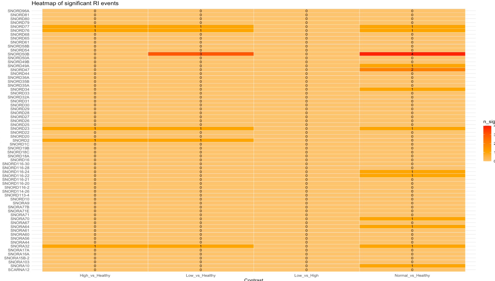

# Transcriptome-AutoPipeline: Integrative RI and snoRT Detection Framework


An automated, reproducible RNA-seq workflow for processing public transcriptomic datasets from raw sequencing data to biologically interpretable splicing outputs, with a specific focus on retained intron (RI) events and snoRNA-retaining transcript (snoRT) discovery. The pipeline now includes a fully leak-free machine learning module for Gleason grade classification using RI-derived PSI features.

---

## Table of Contents

- [Overview](#overview)
- [Biological Context](#biological-context)
- [Pipeline Flowchart](#pipeline-flowchart)
- [Key Features](#key-features)
- [Repository Structure](#repository-structure)
- [Pipeline Workflow](#pipeline-workflow)
- [Core Outputs](#core-outputs)
- [Downstream Statistical Analysis (R)](#downstream-statistical-analysis-r)
- [Machine Learning Module](#machine-learning-module)
- [Requirements](#requirements)
- [Future Work](#future-work)
- [Biological Summary](#biological-summary)
- [Author](#author)

---

## Overview

**Transcriptome-AutoPipeline** is a Python + R workflow designed to re-analyze public RNA-seq datasets (e.g., human cancer cohorts) in a fully automated and reproducible manner.

The pipeline performs the complete transition from raw sequencing data (SRA) to transcript-level quantification, alternative splicing analysis, differential intron retention testing, and downstream machine learning classification of tumor grade based on PSI features. It supports both full dataset processing and biologically informed sample selection through metadata integration.

The primary biological objective is the identification and quantification of **retained intron (RI)** events as a computational entry point for studying **snoRNA-retaining transcripts (snoRTs)** — and their utility as classifiers of prostate cancer aggressiveness.

---

## Biological Context

Many small nucleolar RNAs (snoRNAs) are encoded within intronic regions of host genes. Under normal splicing conditions, these introns are removed and snoRNAs are processed independently.

When **intron retention** occurs, intronic regions containing snoRNA sequences may remain embedded within transcript isoforms — these are referred to as **snoRNA-retaining transcripts (snoRTs)**.

The detection and quantification of retained intron events therefore provides a biologically meaningful strategy to identify candidate snoRT-associated transcripts in RNA-seq datasets. This pipeline operationalizes that strategy across a multi-group prostate cancer cohort, and extends it to a supervised classification task: predicting Gleason grade from RI-derived PSI values.

---

## Pipeline Flowchart

```
flowchart TD
    subgraph META [" Metadata Branch "]
        direction TB
        GEO[GEO]:::meta
        MERGE[Merge SRA and GEO]:::meta
        SEL[Select Samples]:::meta
        GEO --> MERGE --> SEL
    end

    subgraph MAIN [" Main Pipeline "]
        direction TB
        SRA[SRA Archive]:::input
        PRE[prefetch]:::tool
        FQ[fasterq-dump]:::tool
        SAL[Salmon]:::tool
        TPM[TPM Matrix]:::data
        SUP[SUPPA2]:::tool
        RI[RI Events]:::data
        PSI[PSI Output]:::output

        SRA --> PRE --> FQ --> SAL --> TPM --> SUP --> RI --> PSI
    end

    subgraph RANALYSIS [" R Downstream Analysis "]
        direction TB
        RLOAD[Load PSI + Metadata]:::rtool
        WILCOX[Wilcoxon Test per Event]:::rtool
        FDR[BH FDR Correction]:::rtool
        SNORNA[snoRNA-level Summary]:::rout
        VIZ[Visualizations]:::rout
        RLOAD --> WILCOX --> FDR --> SNORNA --> VIZ
    end

    subgraph ML [" Machine Learning Module "]
        direction TB
        MLLOAD[Load PSI + Gleason]:::mltool
        SPLIT[Stratified 80/20 Split]:::mltool
        PREP[Leak-free Preprocessing]:::mltool
        LR[Logistic Regression L2]:::mlout
        SVM[Linear SVM]:::mlout
        EVAL[Evaluation 20 Repeated Splits]:::mlout
        MLLOAD --> SPLIT --> PREP --> LR & SVM --> EVAL
    end

    SEL -->|sample IDs| FQ
    PSI -->|RI_events_with_snoRNA.tsv| RLOAD
    PSI -->|RI_events_with_snoRNA.tsv| MLLOAD
```

---

## Key Features

- Automated download of SRA datasets using `prefetch`
- FASTQ generation via `fasterq-dump`
- Transcriptome indexing and quantification using **Salmon**
- Transcript-level TPM matrix construction
- Integration of GEO and SRA metadata for biologically informed sample selection
- SUPPA2-based alternative splicing event generation
- PSI calculation focused on **retained intron (RI)** events
- **R-based downstream analysis**: Wilcoxon testing, BH FDR correction, snoRNA-level summarization, and differential splicing visualization
- **Python ML module**: fully leak-free Logistic Regression and Linear SVM classification of Gleason grade from PSI features, with 20-split repeated evaluation for robust performance estimation
- Fully reproducible pipeline from raw data to statistical and ML results

---

## Repository Structure

```
Transcriptome-AutoPipeline/
│
├── scripts/
│   ├── transcriptome_pipeline.py
│   ├── transcriptome_pipeline_selected.py
│   └── extract_geo_metadata.py
│
├── ml/
│   └── gleason_lr.py                  ← ML classification module
│
├── figures/
│   ├── heatmap_snorna_RI.png
│   └── gleason_lr_results.png         ← ML output figure
│
├── SraRunTable.csv
├── GSE181294_conditions.csv
├── gencode.v43.transcripts.fa.gz
├── gencode.v43.annotation.gtf
│
├── fastq_output/
├── results/
│   └── event_dPSI_results.tsv
├── salmon_index/
├── events_ioe/
└── suppa_results/
    ├── RI_events_with_snoRNA.tsv      ← annotated PSI matrix (input to R and ML)
    └── RI.psi
```

---

## Pipeline Workflow

### 1. Full Transcriptome Processing

```bash
python3 scripts/transcriptome_pipeline.py
```

Steps: parse SRR IDs → download SRA → convert to FASTQ → build Salmon index → quantify → build TPM matrix → generate splicing events (SUPPA2) → calculate PSI.

### 2. Metadata Integration

```bash
python3 scripts/extract_geo_metadata.py
```

Outputs: `merged_SRA_GEO.csv`, `selected_SRR_ids.txt`

### 3. Selected Sample Processing

```bash
python3 scripts/transcriptome_pipeline_selected.py
```

---

## Core Outputs

| File | Stage | Description |
|---|---|---|
| `quant.sf` | Salmon | Per-transcript quantification |
| `TPM_SUPPA2_final.tsv` | Salmon | TPM matrix across all samples |
| `events_ioe/events_RI_strict.ioe` | SUPPA2 | Retained intron event definitions |
| `suppa_results/RI.psi` | SUPPA2 | PSI values per RI event per sample |
| `RI_events_with_snoRNA.tsv` | Annotation | PSI matrix annotated with snoRNA host gene |
| `event_dPSI_results.tsv` | R | ΔPSI, p-value, FDR per event per contrast |
| `gleason_lr_results.png` | ML | Classification performance figure |

---

## Downstream Statistical Analysis (R)

### Sample Metadata

Samples from `SraRunTable.csv` were classified into four biological groups:

| Group | N samples |
|---|---|
| Healthy | 24 |
| High-grade tumor | 36 |
| Low-grade tumor | 44 |
| Adjacent Normal | 64 |
| **Total** | **168** |

### Statistical Design

**202 unique RI events**, each annotated with a snoRNA host gene, were tested across four contrasts:

| Contrast | Biological Question |
|---|---|
| `Low_vs_Healthy` | Does low-grade tumor alter intron retention vs. healthy? |
| `High_vs_Healthy` | Does high-grade tumor alter intron retention vs. healthy? |
| `Normal_vs_Healthy` | Does field cancerization affect intron retention? |
| `Low_vs_High` | Does tumor grade drive differential intron retention? |

For each (event × contrast) pair:
- **Test**: Wilcoxon rank-sum (non-parametric, robust to PSI distribution skew)
- **Effect size**: ΔPSI = mean(PSI group1) − mean(PSI group2)
- **Multiple testing**: Benjamini–Hochberg FDR correction per contrast

### Results: Significant RI Events

**At FDR < 0.05 (any effect size):**

| Contrast | Sig. Events | min FDR |
|---|---|---|
| Normal_vs_Healthy | **17** | 8.64 × 10⁻⁶ |
| Low_vs_Healthy | **8** | 7.43 × 10⁻¹¹ |
| High_vs_Healthy | 5 | 5.48 × 10⁻⁴ |
| Low_vs_High | **0** | 3.21 × 10⁻¹ |

**At FDR < 0.05 AND |ΔPSI| ≥ 0.10:**

| Contrast | Sig. Events |
|---|---|
| Normal_vs_Healthy | **6** |
| Low_vs_Healthy | **4** |
| High_vs_Healthy | 0 |
| Low_vs_High | 0 |

### Results: snoRNA-Level Summary

| Rank | snoRNA | Contrast | n_sig | Note |
|---|---|---|---|---|
| 1 | **SNORD50B** | Normal_vs_Healthy | **4** | Strongest overall signal |
| 2 | **SNORD50B** | Low_vs_Healthy | **3** | Consistent across 2 contrasts |
| 3 | **SNORD47** | Normal_vs_Healthy | **2** | 2nd-ranking host gene |
| 4 | SNORA32 | High/Low/Normal_vs_Healthy | 1 each | Broadest cross-contrast presence |

### Visualization

[](figures/heatmap_snorna_RI.png)

### R Output Files

| File | Description |
|---|---|
| `results/event_dPSI_results.tsv` | Per-event results: contrast, eventID, snoRNAName, ΔPSI, p-value, FDR |
| `figures/heatmap_snorna_RI.png` | snoRNA × contrast heatmap of n_sig (FDR < 0.05) |

---

## Machine Learning Module

### Overview

`ml/gleason_lr.py` implements a fully leak-free supervised classification pipeline that predicts **Gleason grade** (Low ≤6 vs High ≥7) from retained intron PSI values.

**Dataset:** 136 samples (Low=36, High=100) × 184 RI events, matched between `RI_events_with_snoRNA.tsv` and `SraRunTable.csv` on SRR sample ID.

### Design Principles

**No data leakage.** All preprocessing steps are fitted exclusively on the training set and then applied to the validation set:

```
1. Stratified 80/20 split  ← only step that sees the full dataset
2. SimpleImputer.fit(X_train)  → transform X_val
3. Zero-variance mask from X_train  → apply to X_val
4. StandardScaler.fit(X_train)  → transform X_val
```

**Robust evaluation.** A single 80/20 split on 136 samples gives unreliable estimates (1 misclassification = 3.6% accuracy shift). The pipeline runs **20 repeated stratified splits** and reports mean ± std — this is the number suitable for presentation.

### Models

| Model | Key settings |
|---|---|
| **Logistic Regression** | L2 penalty, C selected by internal 5-fold CV from grid [0.001, 1], `class_weight="balanced"` |
| **Linear SVM** | C=0.1, `class_weight="balanced"`, probabilities via `CalibratedClassifierCV` |

### Results (20 Repeated Stratified Splits)

| Model | AUC | Accuracy | F1 |
|---|---|---|---|
| **Logistic Regression** | **0.930 ± 0.049** | 0.875 ± 0.058 | 0.917 ± 0.037 |
| Linear SVM | 0.926 ± 0.048 | 0.855 ± 0.044 | 0.911 ± 0.024 |

> Both models show consistent performance across splits (low std), indicating the RI-derived PSI signal is reproducible and not an artifact of a single lucky split.

### Top Predictive RI Events (Logistic Regression Coefficients)

**Positive — associated with High Gleason (≥7):**

| Coefficient | Gene | snoRNA |
|---|---|---|
| +0.368 | RPS11 | — |
| +0.256 | SNHG20 | ★ SNORD44 |
| +0.245 | SNHG12 | ★ SNORD50B |
| +0.205 | SNHG29 | ★ SNORD22 |
| +0.196 | SNHG17 | ★ SNORA71 |

**Negative — associated with Low Gleason (≤6):**

| Coefficient | Gene | snoRNA |
|---|---|---|
| −0.309 | SNHG8 | ★ SNORA61 |
| −0.252 | SNHG12 | ★ SNORD50B |
| −0.250 | SNHG29 | ★ SNORD28 |

> **Key observation:** SNHG12 and SNHG29 appear in both lists at different intronic positions — the signal is isoform-specific, not gene-level. This is consistent with snoRT biology: different intron boundaries within the same host gene produce different snoRT candidates.

### How to Run

```bash
# Install dependencies
pip install pandas numpy scikit-learn matplotlib seaborn

# Place input files in the same directory
# - RI_events_with_snoRNA.tsv
# - SraRunTable.csv

python3 ml/gleason_lr.py
```

Output: `gleason_lr_results.png` — three-panel figure showing confusion matrix, ROC curves, and AUC distribution across 20 splits.

### Interpretation Note

Training accuracy is 1.0 (expected given n ≈ p in this dataset). The validation AUC of **0.930 ± 0.049** reflects genuine generalization, not memorization — confirmed by the stability across 20 independent splits. These findings are exploratory and require validation in an independent cohort.

---

## Requirements

### Python

- Python ≥ 3.8
- `pandas`, `numpy`, `scikit-learn`, `matplotlib`, `seaborn`
- SRA Toolkit, Salmon, SUPPA2

```bash
pip install pandas numpy scikit-learn matplotlib seaborn
```

### R

- R ≥ 4.4.0
- `readr`, `dplyr`, `tidyr`, `stringr`, `purrr`, `tibble`, `ggplot2`

```r
install.packages(c("readr","dplyr","tidyr","stringr","purrr","tibble","ggplot2"))
```

---

## Future Work 🚀

- [ ] **QC integration** — Add FastQC / MultiQC module + optional trimming
- [ ] **Paired-end support** — Extend Salmon quantification for paired-end datasets
- [ ] **snoRT isoform confirmation** — Intersect candidate RI events with snoRNA genomic coordinates to confirm snoRNA sequence is embedded in the retained intron
- [ ] **Expression integration** — Combine TPM and PSI to prioritize events with both high expression and high intron retention
- [ ] **Independent cohort validation** — Apply ML module to a held-out external dataset to validate AUC estimates
- [ ] **Permutation testing** — Add statistical significance test for ML results (p-value for AUC vs. null distribution)
- [ ] **Survival correlation** — Link snoRT candidates to clinical outcomes using TCGA metadata
- [ ] **Gene ontology / pathway analysis** — Functional annotation of host genes with significant RI events

---

## Biological Summary

Transcriptome-AutoPipeline provides a robust and automated framework for RNA-seq analysis, focusing on transcript quantification and retained intron detection in a prostate cancer cohort.

Across **168 samples** and **202 annotated RI events**, the pipeline identified:

- **SNORD50B** as the top snoRT candidate — 7 significant RI events across two independent tumor-vs-healthy contrasts
- **SNORA32** as the most broadly altered snoRNA — signal in 3 of 4 contrasts, grade-independent
- **Zero significant events** in `Low_vs_High`, indicating tumor grade alone does not drive differential intron retention
- The dominant signal in `Normal_vs_Healthy` (17 events at FDR < 0.05), consistent with field cancerization

The machine learning module further demonstrates that the **aggregate PSI signature across 137 RI events** is sufficient to classify Gleason grade with AUC = 0.930 ± 0.049, with snoRNA host genes (SNHG12, SNHG20, SNHG29, SNHG8) among the strongest individual predictors.

---

## Author

**Kiarash Babaei**
MSc Medical Biotechnology — Computational Biology/Bioinformatics
University of Bologna

[](https://linkedin.com/in/kiarashbabaei)
