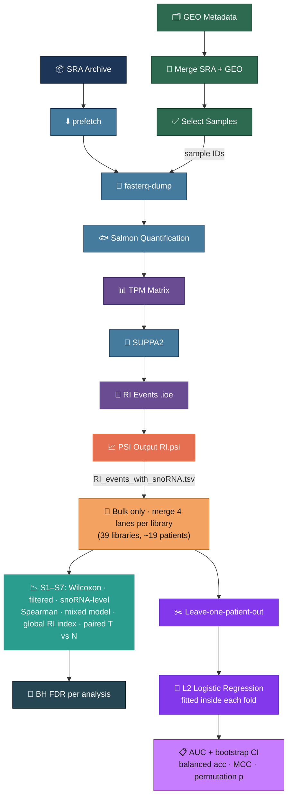
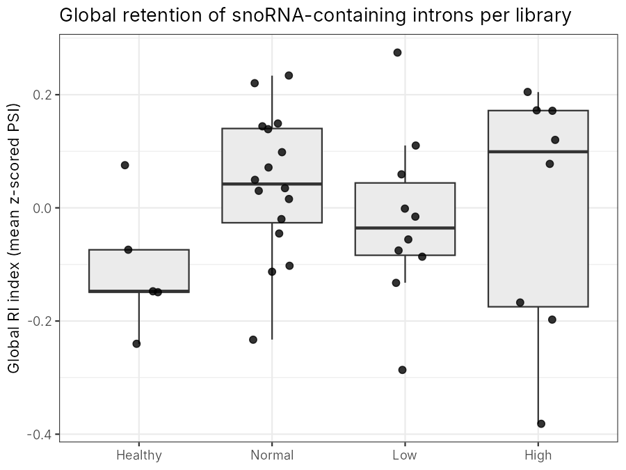
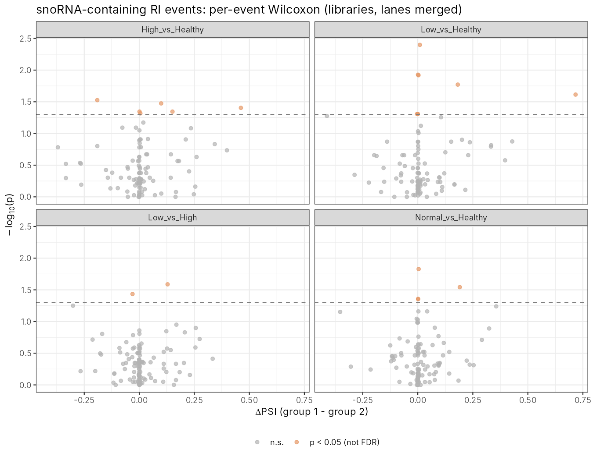
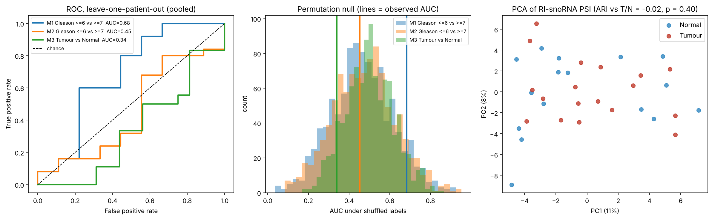

# Transcriptome-AutoPipeline: Integrative RI and snoRT Detection Framework


An automated, reproducible RNA-seq workflow for processing public transcriptomic datasets from raw sequencing data to biologically interpretable splicing outputs, with a specific focus on retained intron (RI) events and snoRNA-retaining transcript (snoRT) discovery. Downstream statistics (R) and machine learning (Python) are replication-aware: technical sequencing lanes are merged per library and all evaluation is done at patient level.

> **Note on results (v2, November 2026).** An earlier version of this repository reported 17 significant RI events and a Gleason classifier with AUC 0.93. Those numbers were inflated by counting the 4 sequencing lanes of each library as separate samples, by mixing 12 single-cell runs with bulk data, and by splitting tumour and normal tissue of the same patient across training and validation sets. The corrected analysis is described below; the previous version is preserved under the tag [`v1-before-correction`](https://github.com/KiarashBabaei/Transcriptome-AutoPipeline/tree/v1-before-correction).

---

## Table of Contents

- [Overview](#overview)
- [Biological Context](#biological-context)
- [Pipeline Flowchart](#pipeline-flowchart)
- [Key Features](#key-features)
- [Repository Structure](#repository-structure)
- [Pipeline Workflow](#pipeline-workflow)
- [Core Outputs](#core-outputs)
- [Dataset Structure: Runs, Libraries and Patients](#dataset-structure-runs-libraries-and-patients)
- [Downstream Statistical Analysis (R)](#downstream-statistical-analysis-r)
- [Machine Learning Module](#machine-learning-module)
- [Correction Log: What Changed from v1](#correction-log-what-changed-from-v1)
- [Requirements](#requirements)
- [Future Work](#future-work)
- [Biological Summary](#biological-summary)
- [References](#references)
- [Author](#author)

---

## Overview

**Transcriptome-AutoPipeline** is a Python + R workflow designed to re-analyze public RNA-seq datasets (e.g., human cancer cohorts) in a fully automated and reproducible manner.

The pipeline performs the complete transition from raw sequencing data (SRA) to transcript-level quantification, alternative splicing analysis, differential intron retention testing, and machine learning on PSI features. It supports both full dataset processing and biologically informed sample selection through metadata integration.

The primary biological objective is the identification and quantification of **retained intron (RI)** events as a computational entry point for studying **snoRNA-retaining transcripts (snoRTs)**, and testing whether they differ between healthy prostate, adjacent normal tissue and tumours of different grades.

---

## Biological Context

Many small nucleolar RNAs (snoRNAs) are encoded within intronic regions of host genes. Under normal splicing conditions, these introns are removed and snoRNAs are processed independently.

When **intron retention** occurs, intronic regions containing snoRNA sequences may remain embedded within transcript isoforms — these are referred to as **snoRNA-retaining transcripts (snoRTs)**.

The detection and quantification of retained intron events therefore provides a biologically meaningful strategy to identify candidate snoRT-associated transcripts in RNA-seq datasets. snoRTs remain an understudied class of transcripts; this pipeline operationalizes the strategy across a multi-group prostate cancer cohort.

---

## Pipeline Flowchart



---

## Key Features

- Automated download of SRA datasets using `prefetch`
- FASTQ generation via `fasterq-dump`
- Transcriptome indexing and quantification using **Salmon**
- Transcript-level TPM matrix construction
- Integration of GEO and SRA metadata for biologically informed sample selection
- SUPPA2-based alternative splicing event generation
- PSI calculation focused on **retained intron (RI)** events overlapping snoRNAs
- **Replication-aware statistics (R)**: lane merging per library, seven pre-specified analyses including linear mixed models and paired tumour vs normal tests
- **Patient-level ML evaluation (Python)**: leave-one-patient-out validation, permutation testing and bootstrap confidence intervals
- Fully reproducible pipeline from raw data to statistical and ML results

---

## Repository Structure

```
Transcriptome-AutoPipeline/
│
├── scripts/
│   ├── transcriptome_pipeline.py
│   ├── transcriptome_pipeline_selected.py
│   ├── extract_geo_metadata.py
│   └── run_statistical_analysis.R     ← statistics S1–S7
│
├── ml/
│   └── gleason_lr.py                  ← ML analyses M0–M4
│
├── metadata/
│   └── SraRunTable.csv
│
├── figures/
│   ├── S1_volcano_RI_events.png
│   ├── S6_global_RI_index.png
│   └── ml_results.png
│
├── results/
│   ├── RI_events_with_snoRNA.tsv      ← annotated PSI matrix (input to R and ML)
│   ├── stats/                         ← R output tables
│   └── ml/                            ← ML output tables
│
├── GSE181294_conditions.csv
├── gencode.v43.transcripts.fa.gz
├── gencode.v43.annotation.gtf
├── fastq_output/
├── salmon_index/
├── events_ioe/
└── suppa_results/
    └── RI.psi
```

---

## Pipeline Workflow

### 1. Full Transcriptome Processing

```bash
python3 scripts/transcriptome_pipeline.py
```

Steps: parse SRR IDs → download SRA → convert to FASTQ → build Salmon index → quantify → build TPM matrix → generate splicing events (SUPPA2) → calculate PSI.

### 2. Metadata Integration

```bash
python3 scripts/extract_geo_metadata.py
```

Outputs: `merged_SRA_GEO.csv`, `selected_SRR_ids.txt`

### 3. Selected Sample Processing

```bash
python3 scripts/transcriptome_pipeline_selected.py
```

### 4. Statistics and Machine Learning

Run from the repository root, with `results/RI_events_with_snoRNA.tsv` and `metadata/SraRunTable.csv` in place:

```bash
Rscript scripts/run_statistical_analysis.R     # ~30 s
python3 ml/gleason_lr.py                       # ~2 min (1,000 permutations)
```

---

## Core Outputs

| File | Stage | Description |
|---|---|---|
| `quant.sf` | Salmon | Per-transcript quantification |
| `TPM_SUPPA2_final.tsv` | Salmon | TPM matrix across all samples |
| `events_ioe/events_RI_strict.ioe` | SUPPA2 | Retained intron event definitions |
| `suppa_results/RI.psi` | SUPPA2 | PSI values per RI event per sample |
| `results/RI_events_with_snoRNA.tsv` | Annotation | PSI matrix of RI events overlapping snoRNAs |
| `results/stats/SUMMARY_all_analyses.tsv` | R | Number of tested and significant features per analysis and contrast |
| `results/stats/S1…S7_*.tsv` | R | Per-feature statistics (ΔPSI, effect size, p, FDR) |
| `results/ml/ML_summary.tsv` | ML | AUC, CI, balanced accuracy, MCC, permutation p per analysis |
| `results/ml/M1_coefficients_exploratory.tsv` | ML | Model coefficients (exploratory only) |

---

## Dataset Structure: Runs, Libraries and Patients

The cohort is BioProject PRJNA751490 (NextSeq 500). The run table lists 168 SRR runs, but these are not independent samples:

| Level | Count | Note |
|---|---|---|
| SRR runs | 168 | |
| Single-cell runs | 12 | Different assay (40–58 bp reads); excluded from the main analysis |
| Bulk runs | 156 | 91–92 bp reads |
| Bulk libraries (BioSamples) | 39 | Each sequenced on **4 lanes** = 4 runs → PSI averaged per library |
| Libraries with Gleason score | 34 | 18 tumour, 16 adjacent normal |
| Patients (proxy: age + Gleason) | ~19 | Most contribute one tumour and one normal library |

Bulk libraries per group: **Healthy 5, Normal 16, Low grade 10, High grade 8** (authors' `grade` annotation: low = Gleason 6–7, high = ≥ 8).

The run table contains no patient ID, so patients are inferred from age and Gleason string.

**Events:** 184 unique RI events overlapping 67 snoRNAs (202 rows, because 18 introns host two snoRNAs; such events are tested once).

---

## Downstream Statistical Analysis (R)

`scripts/run_statistical_analysis.R`

### Design (fixed before looking at results)

- Unit of analysis = library (4 lanes merged); bulk libraries only
- Benjamini–Hochberg FDR within each analysis and contrast
- Every analysis is reported, significant or not

| ID | Analysis |
|---|---|
| S1 | Per-event Wilcoxon rank-sum, all events, 4 contrasts (+ Hodges–Lehmann estimate and 95% CI) |
| S2 | Same as S1 after label-free independent filtering (measured in ≥ 80% of libraries, SD ≥ 0.01) |
| S3 | snoRNA-level Wilcoxon (PSI averaged over the events of each snoRNA) |
| S4 | Spearman correlation of PSI with Gleason score (tumour libraries) |
| S5 | Linear mixed model on lane-level data: `PSI ~ group + (1 \| library)` |
| S6 | Global RI index (mean z-scored PSI per library): 4 contrasts + paired tumour vs normal |
| S7 | Paired Wilcoxon signed-rank, tumour vs adjacent normal within patient |

Contrasts: `Low_vs_Healthy`, `High_vs_Healthy`, `Normal_vs_Healthy`, `Low_vs_High`.

### Results

**No event, snoRNA or global index is significant after FDR correction in any of the seven analyses.**

| Analysis | Strongest contrast | Features with p < 0.05 | FDR < 0.05 | Lowest FDR |
|---|---|---|---|---|
| S1 per-event | Low vs Healthy | 8 / 109 | 0 | 0.44 |
| S2 filtered | Low vs Healthy | 2 / 59 | 0 | 0.24 |
| S3 snoRNA-level | Low vs Healthy | 5 / 57 | 0 | 0.23 |
| S4 Spearman vs Gleason | — | 5 / 114 | 0 | 0.41 |
| S5 mixed model | Low vs Healthy | 5 / 114 | 0 | 0.65 |
| S6 global RI index | Normal vs Healthy | 1 / 1 (p = 0.043) | 0 | 0.22 |
| S7 paired T vs N | — | 6 / 109 | 0 | 0.75 |

Nominal trends (hypothesis-generating only): contrasts against Healthy repeatedly show more nominal signals than within-patient contrasts, and Healthy libraries have the lowest global RI index. Recurring snoRNAs among the lowest p-values: SNORD23, SNORD50B, SNORA32, SNORD49A. With only 5 Healthy libraries these are trends, not findings.

**Candidate snoRNAs for follow-up.** Because the healthy group comprised only five libraries, no signal survived FDR correction. Nevertheless, in the comparison of low-grade tumours with healthy tissue, SNORD50B (snoRNA-level ΔPSI ≈ 0.17, raw p = 0.023) and, to a lesser extent, SNORD23 (raw p = 0.004 but ΔPSI < 0.01) showed preliminary patterns that merit testing in a larger, independent cohort. The SNORD50 locus is of particular interest: its paralog SNORD50A (U50), encoded within a host-gene intron, has been proposed as a candidate tumour suppressor in prostate cancer [1], and SNORD50A/B are recurrently deleted across cancers and bind K-Ras [2]. These studies concern gene deletion rather than intron retention, so they motivate follow-up but do not corroborate the present trend.





**Sensitivity analysis.** Tumour vs Healthy tested in single-cell runs alone (8 vs 4), bulk alone (18 vs 5), and combined with technology as a covariate: no FDR-significant event in any setting.

---

## Machine Learning Module

`ml/gleason_lr.py`

### Design (fixed before looking at results)

- One model for every task: L2 logistic regression, C = 0.1, `class_weight="balanced"`
- Missing-value filter, median imputation, zero-variance filter and scaling fitted **inside each training fold**
- **Leave-one-patient-out** validation: all libraries of a patient are held out together
- Metrics: ROC-AUC with 95% patient-bootstrap CI (2,000 resamples), balanced accuracy, MCC, permutation p-value (1,000 label shuffles at patient level, full evaluation re-run)

| ID | Task |
|---|---|
| M0 | Naive evaluation (runs as samples, random 80/20 × 20) — reference only, shows the leakage |
| M1 | Gleason ≤ 6 vs ≥ 7 from event-level PSI |
| M2 | Gleason ≤ 6 vs ≥ 7 from snoRNA-level PSI |
| M3 | Tumour vs adjacent normal from event-level PSI |
| M4 | Unsupervised PCA + hierarchical clustering vs tumour/normal labels (adjusted Rand index) |

### Results

| Analysis | AUC (95% CI) | Balanced accuracy | MCC | Permutation p |
|---|---|---|---|---|
| M0 naive (reference only) | 0.920 ± 0.042 | — | — | — |
| **M1 Gleason, event PSI** | **0.684 (0.31–0.95)** | 0.642 | 0.296 | 0.082 |
| M2 Gleason, snoRNA PSI | 0.453 (0.17–0.71) | 0.507 | 0.013 | 0.567 |
| M3 Tumour vs Normal | 0.340 (0.20–0.48) | 0.403 | −0.203 | 0.912 |
| M4 Unsupervised | ARI −0.015 | — | — | 0.399 |

M1 (34 libraries, ~19 patients, 9 Low / 25 High) shows a weak signal that does not reach significance. Its plain accuracy (73.5%) equals the majority-class baseline, which is why balanced accuracy and MCC are reported. The below-chance AUC in M3 is a known small-sample artefact of leave-one-out evaluation, not a reversed signal.



Model coefficients are saved in `results/ml/M1_coefficients_exploratory.tsv` and should not be interpreted as biomarkers.

---

## Correction Log: What Changed from v1

| Issue in v1 | Effect | Fix in v2 |
|---|---|---|
| 4 sequencing lanes per library counted as 4 samples | Sample size inflated ~4×; p-values too small; lanes of one library in both train and validation sets | PSI averaged per library; mixed model (S5) uses lanes correctly |
| 12 single-cell runs mixed with bulk (4 in Healthy, 0 in Normal) | Technology confounded with group | Bulk only; single-cell tested separately as sensitivity analysis |
| Tumour and normal of the same patient split across train/validation | Model could learn patient identity | Leave-one-patient-out |
| Accuracy and F1 reported on imbalanced data | 87.5% accuracy vs 73.5% majority baseline | AUC with CI, balanced accuracy, MCC, permutation p |

| Result | v1 | v2 |
|---|---|---|
| Normal vs Healthy significant events | 17 | 0 (4 after removing single-cell only) |
| Gleason classifier AUC | 0.930 | 0.684 (p = 0.08) |

---

## Requirements

### Python

- Python ≥ 3.8
- `pandas`, `numpy`, `scikit-learn`, `scipy`, `matplotlib`, `joblib`
- SRA Toolkit, Salmon, SUPPA2

```bash
pip install pandas numpy scikit-learn scipy matplotlib joblib
```

### R

- R ≥ 4.3
- `readr`, `dplyr`, `tidyr`, `stringr`, `purrr`, `tibble`, `ggplot2`, `lme4`, `lmerTest`

```r
install.packages(c("readr","dplyr","tidyr","stringr","purrr","tibble","ggplot2","lme4","lmerTest"))
```

---

## Future Work

- [ ] **Power analysis** — Estimate the sample size needed to confirm the observed trends
- [ ] **Independent validation (TCGA-PRAD)** — Run SUPPA2 on precomputed isoform TPMs (UCSC Xena, GENCODE v23); test pre-specified hypotheses on ~500 tumours and paired tumour/normal samples
- [ ] **Second raw-data cohort (GSE54460)** — Apply the full pipeline to ~100 FFPE prostatectomy samples with Gleason scores
- [ ] **Confirm patient IDs** from GEO sample annotations
- [ ] **QC integration** — Add FastQC / MultiQC module + optional trimming
- [ ] **Expression integration** — Combine TPM and PSI to prioritize events with both high expression and high intron retention
- [ ] **Survival correlation** — Link snoRT candidates to clinical outcomes using TCGA metadata

---

## Biological Summary

Transcriptome-AutoPipeline automates RNA-seq analysis from raw public data to snoRNA-specific retained-intron profiles. In a prostate cancer cohort (39 bulk libraries from ~19 patients and 5 healthy donors) it identified **184 RI events overlapping 67 snoRNAs**.

After replication-aware analysis, no RI event differed significantly between groups, and RI-based classification of Gleason grade did not exceed chance at the 0.05 level (AUC 0.68, p = 0.08). Nominal trends — lower global retention in healthy tissue and preliminary patterns for SNORD50B and SNORD23 in low-grade tumours vs healthy tissue — are hypotheses for validation in larger, independent cohorts; the SNORD50 locus is a priority given its prior links to prostate cancer [1, 2]. The study is best read as an exploratory pilot in an understudied area, and as a worked example of how technical replicates and patient-level leakage can inflate results from public SRA data.

---

## References

1. Dong XY, Rodriguez C, Guo P, et al. SnoRNA U50 is a candidate tumor-suppressor gene at 6q14.3 with a mutation associated with clinically significant prostate cancer. *Hum Mol Genet.* 2008;17(7):1031–1042. [doi:10.1093/hmg/ddm375](https://doi.org/10.1093/hmg/ddm375)
2. Siprashvili Z, Webster DE, Johnston D, et al. The noncoding RNAs SNORD50A and SNORD50B bind K-Ras and are recurrently deleted in human cancer. *Nat Genet.* 2016;48(1):53–58. [doi:10.1038/ng.3452](https://doi.org/10.1038/ng.3452)

---

## Author

**Kiarash Babaei**
MSc Medical Biotechnology — Computational Biology/Bioinformatics
University of Bologna

[](https://linkedin.com/in/kiarashbabaei)
